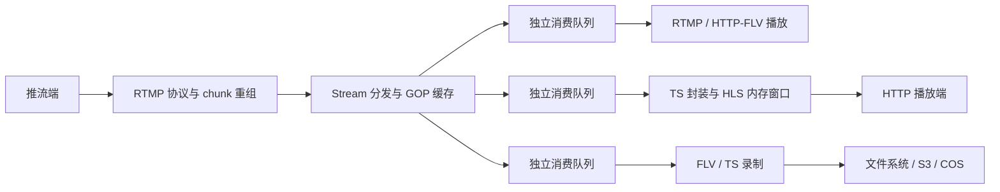
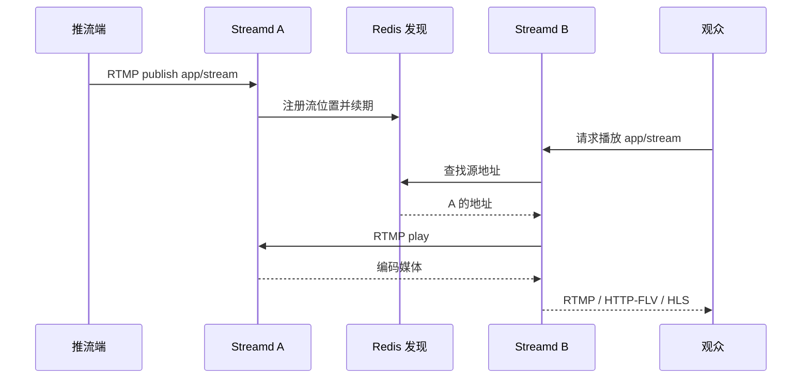
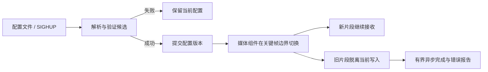
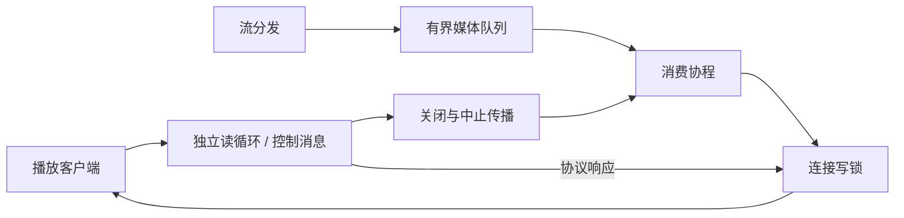

# 架构与数据流

## 一次接入，多路输出

`rtmp/core` 负责握手、chunk 重组、控制消息和连接读写；`rtmp/stream.go` 管理流和分发；`packet` 定义媒体包与边界，`container` 做 FLV/TS 封装，`hls` 与 `record` 管理各自生命周期。

新观众需要编码头和可解码的 GOP 起点，不能只接收任意位置的后续帧。`gop` 保存启动数据；每个消费者通过 `core.Funnel` 独立排队并调整自身时间轴。队列满时返回饱和错误，分发侧淘汰该消费者，避免用无限积压维持表面上的连接存活；录制失败也不应直接中断其他播放器。

## 两台服务器之间按需拉流

Redis 是可选的发现路径；已知上游地址时可配置静态拉流，也可通过管理接口启动动态 relay。源节点需要已有可用媒体；没有媒体时，发现服务不会凭空产生流。

按需回源避免为每个边缘节点持续镜像全部频道；同一节点并发请求同一流时复用回源连接。收益取决于哪些频道实际有人观看，不能固定承诺节省某个百分比。跨节点输出仍消耗带宽，发现记录也不是分布式写入锁。

实现入口：[`rtmp/origin.go`](../rtmp/origin.go)、[`config/finder.go`](../config/finder.go)、[`rtmp/core/dynamic.go`](../rtmp/core/dynamic.go)。发现使用 Redis TTL、通知及轮询，注册地址必须能被其他节点访问。

真实双进程测试见 [`scripts/e2e/relay.go`](../scripts/e2e/relay.go)：先向 A 推流，再启动 B 的拉流；验证三种播放协议、动态 relay 启停、静态推送目标恢复及录制输出。`origin` 场景覆盖按需回源路径。

## 配置切换与录制收尾

配置先验证后提交；监听地址变更不能通过普通热加载悄悄替换。HLS 与录制在视频关键帧边界应用相关变化，以免在半个 GOP 中间切换封装参数。组件状态由 `internal/appstate` 报告，配置版本与实际媒体切换时刻并非同一个概念。

录制把当前写入与旧片段完成分开，限制同时完成任务数量，存储检查也使用有界调度；这些边界减少存储延迟对媒体路径的影响，但不意味着任意存储故障都能恢复。恢复依赖有效数据和 checkpoint。

HLS 的 m3u8 与播放切片由内存窗口服务；本地录制输出 TS/FLV 文件，**不会自动生成录制回放 m3u8**。生命周期 HTTP 回调为异步尽力交付，不是持久消息队列。

## IO 读写分离：控制消息与媒体发送各司其职

RTMP 播放连接虽然持续向观众发送媒体，仍需要读取对端控制消息和连接关闭事件。`NewWriter` 启动独立的 `connRead` 协程，`Funnel.processor` 则消费媒体队列并写出；读取退出时关闭连接并中止消费队列，避免留下只写不读的孤立任务。

[`NewReadWriter`](../rtmp/core/io_base.go) 为读写方向分别创建 `bufio.Reader` 和 `bufio.Writer`；[`Conn.Write`](../rtmp/core/message_conn.go) 使用写锁保护完整 chunk 写入，避免媒体和控制响应交叉破坏协议。读写独立不等于所有路径无锁，也不是数据库主从意义上的读写分离。

它把网络读取、媒体分发和消费者输出分成不同阶段，采用有界队列隔离瞬时速度差；持续慢速的消费者会被淘汰，而不是不断扩大队列。这与 Go 官方介绍的 [pipeline、取消和有界并行](https://go.dev/blog/pipelines) 思路一致，但这里的各消费端接收同一流的广播，而不是把不同任务分摊给 worker。

这类设计的价值是减少相互等待、明确关闭传播和资源边界，不能据此声称任何网络阻塞都被消除；协议响应仍可能等待连接写锁，操作系统发送缓冲和对端速度也影响写入耗时。

相关量化见 [慢消费者隔离与断连回收](io-isolation.md)：包含实测图表、原始数据与测量边界。
