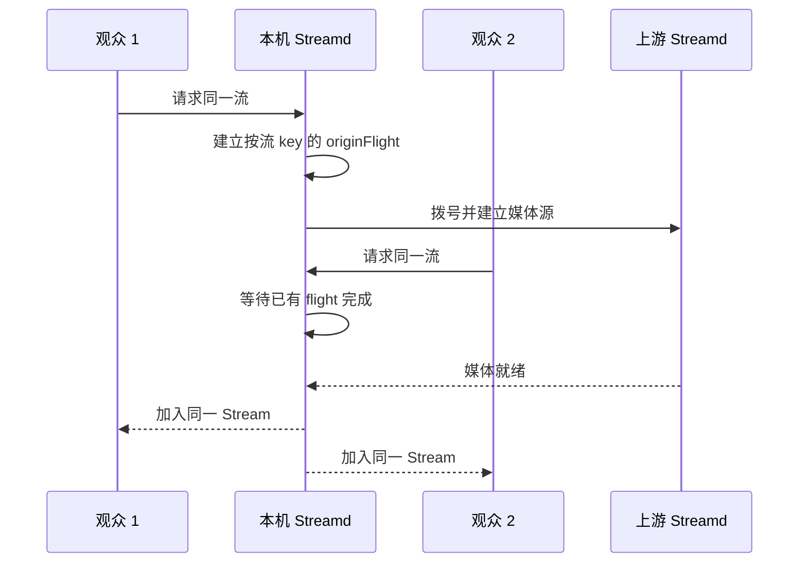
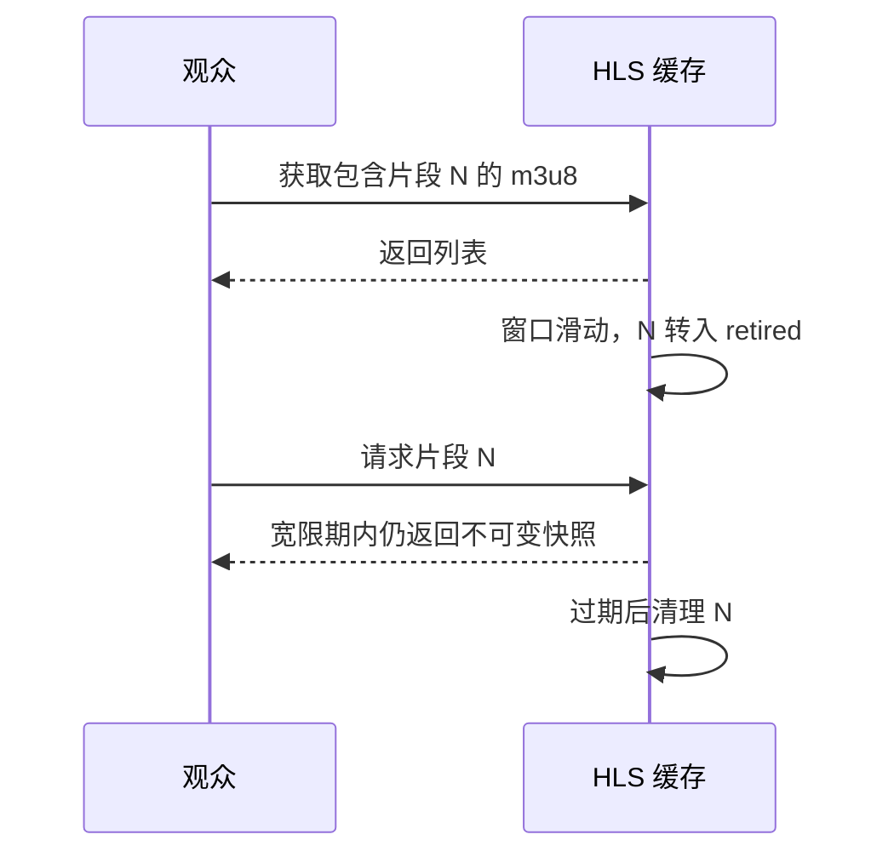

# 媒体处理的设计取舍

本文介绍媒体处理中的分配、等待和生命周期管理，架构总览见 [architecture.md](architecture.md)，数据见 [performance.md](performance.md)。

## 1. 小包分块：出发点是分配与 GC 的 CPU 压力

一条流不断产生音频包、视频包和控制消息，多路并发会放大堆分配速率；运行时分配、垃圾回收及必要的 GC assist 都可能挤占媒体处理 CPU。因此这里关注的不只是“少调用几次 make”，而是降低持续流量下的内存管理开销。

Streamd 按连接持有 slab，小包从默认 256KiB 的块里顺序切出；大于块上限的包独立申请。若剩余空间放不下当前包，但仍大于 64KiB 保留阈值，则让当前包独立申请，留着尾部给后续小包，避免一次偶发大帧浪费整段余量。

例如当前块还剩 100KiB，遇到 120KiB 包：本次独立申请，下一批 1KiB 小包仍可使用那 100KiB；若只剩 20KiB，则切换新块。旧块不会被覆盖，它会等所有切片引用消失后由 GC 回收。

Go 的 GC 频率同时受分配字节速率、存活堆、指针结构、GOGC 和内存限制影响；少分配对象不自动等于 GC 次数同比减少。纯字节数组不含待扫描的内部指针，也不能按媒体字节数直接推算扫描工作量。当前微基准证明小包分配次数和耗时下降；[等量工作测量](performance.md)测得 GC CPU 估计值仅下降约 8.6%，远小于总耗时的降幅，不能把该耗时差全算作 GC 收益；其 B/op 基本相同，也不支持“省了同等比例内存”的说法。

块过大还可能让一个小切片留住整块内存，内存限额过紧时反而增加 GC 压力。选块大小应结合包长分布和真实持有时间，使用 CPU profile、GC CPU/周期、分配字节速率与存活堆共同验证；不能只看暂停时间或 RSS。

代码：[`Slab.Get`](../rtmp/core/slab.go)；机制依据：[Go GC 指南](https://go.dev/doc/gc-guide)。

## 2. 共享载荷，独立时间轴：少复制也不串状态

同一帧要发给多个观众，若每个观众复制整段音视频字节，复制和分配开销会随观众数增长；但直接让所有消费者修改同一个 Packet，又会使重连、时间戳调整互相干扰。

`Funnel.processor` 先浅复制 Packet，再计算该消费者的 Baseline；Data/Media 仍引用同一份媒体载荷。复制的是小型描述信息，保留的是大载荷共享，网络协议封装仍由各输出端完成。

这要求共享载荷保持只读；编码序列头需要独立保存，完成的 HLS 切片需要隔离封装缓冲，所以这些生命周期边界反而有意复制。

代码：[`Funnel.processor`](../rtmp/core/funnel.go)、[`SequenceHeaders.Observe`](../packet/boundary.go)；测试：[`packet/boundary_test.go`](../packet/boundary_test.go)。

## 3. 同流回源合并：一次建流，多人复用

多个观众同时请求尚未在本机建立的流，如果每个请求都拨一次上游，会在首播瞬间形成重复连接、重复媒体流和注册竞争。

按流 key 的锁保护检查和 flight 登记，网络拨号放到锁外；其他请求等待 flight 完成，再检查源是否可用并加入。失败会结束这一轮等待，不会把失败当成可播放流；节点关闭也会取消等待。

这一机制类似 singleflight，合并同一节点、同一流正在进行的回源工作；不同频道独立执行，各节点分别建立自己的回源连接。

代码：[`installOriginWriter`](../rtmp/origin.go)；测试：[`rtmp/origin_regression_test.go`](../rtmp/origin_regression_test.go)、[`scripts/e2e/origin.go`](../scripts/e2e/origin.go)。

## 4. 关键帧边界切换：配置提交不等于媒体立即切换

视频的帧间依赖使任意时刻切换 HLS 或录制参数容易留下不可独立解码的片段。系统先提交合法配置，媒体组件在合适的视频关键帧处应用变化；必要时回放编码头，使新输出有正确的启动信息。

配置提交后，管理状态分别报告组件正在等待或已经应用；实际生效时间取决于下一关键帧到达的时刻。

代码：[`hls/stream.go`](../hls/stream.go)、[`record/switcher.go`](../record/switcher.go)；测试：[`hls/boundary_test.go`](../hls/boundary_test.go)、[`hls/reload_test.go`](../hls/reload_test.go)。

## 5. 录像异步收尾：把慢存储的尾部工作移出当前写入

旧片段结束不意味着文件上传或存储完成立刻结束；若在媒体路径同步等待，慢存储可能拖住后续录制处理。切换时先把旧 terminal 脱离当前写入，由后台完成，错误仍上报组件状态。

但后台任务必须有上限：录制配置切换层最多保留三个正在完成的 recording；达到上限或新旧目标存在冲突时进入 `waiting_finalization`，而不是无限启动任务。等待完成期间录制可能暂停，其他播放消费者仍由独立队列处理。

组件状态报告待完成任务和错误，便于定位存储延迟与录制暂停。

代码：[`record/finalization.go`](../record/finalization.go)、[`record/storage/finalization.go`](../record/storage/finalization.go)；测试：[`record/finalization_test.go`](../record/finalization_test.go)。

## 6. HLS 退役宽限：播放列表过期不等于切片立刻失效

观众拿到 m3u8 与请求 TS 是两个不同的 HTTP 请求；窗口恰好滑动时，若立即删除移出列表的切片，就会出现“刚拿到合法地址却 404”的竞态。

退役片段的保留时间结合当前窗口时长、之前窗口长度与片长计算，而非永久保存；窗口缩小时也考虑旧窗口。快照保证正在发送的数据不被封装缓冲复用破坏，宽限保证请求时序有容错空间。

代价是缓存会暂时大于当前播放列表的大小，保留字节数还受码率影响；超出宽限期的片段将被清理。

代码：[`TsItemCache.trimLocked`](../hls/item/cache.go)；测试：[`hls/item/reload_test.go`](../hls/item/reload_test.go)。

## 与已有方案如何比较

SRS 官方文档已有 [merged read/write 与 GOP 缓存](https://ossrs.io/lts/en-us/docs/v5/doc/low-latency)设计；批量读写旨在摊薄系统调用，而本项目描述的读写分离强调两个方向的独立推进，两者不是同一概念。内存分块、流水线和共享缓冲也有成熟业界先例，参见 [内存设计](memory.md)。

[现有性能数据](performance.md)涵盖本项目的分配器和受限负载测试，尚未包含与 SRS 在相同环境下的性能对照。
