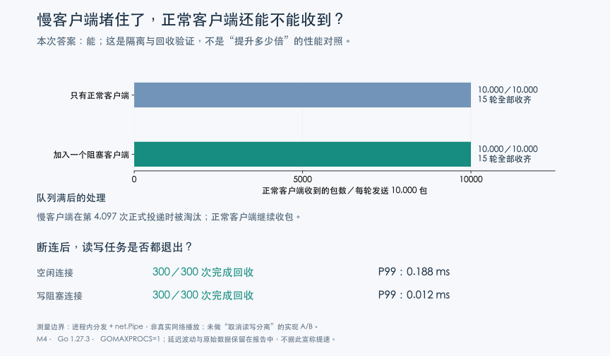

# IO 解耦：慢消费者隔离与断连回收

读写协程、有界队列和关闭传播解决的是不同问题：独立读循环发现对端关闭，消费者队列隔离输出阻塞，连接关闭打断阻塞 IO 并等待协程退出；本次测量验证这些机制组合后的表现，**不是关闭这些机制后的实现 A/B，也没有测出某项设计的独立提速倍数**。

## 方法

版本 `b3189ff`，Apple M4、darwin/arm64、Go 1.27.3；`GOMAXPROCS=1`、`GOGC=100`、`GOMEMLIMIT=256MiB`（软限制），每个测试进程超时 90 秒。

复用真实 `Stream.dispatch`、`Funnel`、`NewWriter`，通过临时同包测试访问内部入口，不改产品实现：

- 分发：正常消费者使用真实 Funnel 加一个记录收包时间的终端，对照组再加入一个写入后永久等待的消费者；每组 10,000 包、每个进程交替顺序测 5 轮，共 3 个进程，即每种条件 15 次测量。
- 正常消费者每收到一包，生产者才发下一包；使用共享的 3 字节音频包，因此这里的速率是**逐包确认的进程内分发速率**，不是网络吞吐、码率或并发容量。
- 预热投递一包，确保慢消费者已进入阻塞写；随后队列最多容纳 4,096 包，第 4,097 次正式投递触发淘汰；单独统计前 4,000 包延迟，以免淘汰后的数据掩盖影响。
- 延迟从调用 dispatch 前计时，到正常终端进入 Write 时结束；不包含真实编码、套接字发送或播放器解码。
- 断连：真实 RTMP Writer 接 `net.Pipe`，分别测空闲连接和已确认进入阻塞写的连接；对端 Close 起计时，直到 `Wait` 返回、队列清空、控制读协程退出，各 300 次。
- CPU 使用进程 `getrusage` 用户态与内核态时间差；分配量使用 `runtime.MemStats.TotalAlloc` 差值，包括测试通道、超时计时器与统计开销，不代表保留堆或 RSS。

## 结果

分发指标为 15 次测量各自统计值的中位数，图上的散点保留全部轮次；不是将全部包混合计算的总体 P99。

| 指标 | 只有正常消费者 | 增加阻塞消费者 |
|---|---:|---:|
| 淘汰前区间 P95（µs） | 0.583 | 0.541 |
| 淘汰前区间 P99（µs） | 0.625 | 0.584 |
| 全程逐包确认速率（百万包/秒） | 1.193 | 1.254 |
| 全程进程 CPU（ms） | 8.360 | 7.959 |
| 全程累计分配（bytes） | 4,481,920 | 4,482,904 |
| 全程 GC 次数 | 1 | 1 |

正常消费者每次均收齐 10,000 个正式包，慢消费者每次均在第 4,097 次正式投递被淘汰；两组数值接近，但单轮仅约毫秒量级、存在预热与调度波动，**不能把阻塞组略快解释为性能提升，也不能据此断言任意负载下延迟不变**。

| 对端断开到回收完成 | P50（µs） | P95（µs） | P99（µs） | 最大值（µs） |
|---|---:|---:|---:|---:|
| 空闲连接，300 次 | 4.042 | 12.250 | 188.292 | 201.708 |
| 写阻塞连接，300 次 | 3.584 | 7.041 | 12.458 | 114.375 |

两类连接均全部完成回收；空闲组尾部更高不意味着空闲连接本质上更难回收，测试会受到协程首次调度等因素影响，未进一步归因；`net.Pipe` 不含 TCP 缓冲、网络时延与操作系统断连检测，线上回收时延须另测。

## 合适的术语与设计边界

- **Producer–Consumer（生产者—消费者）／Pipeline（流水线）**：分发负责入队，各消费者协程负责写出，阶段间通过队列衔接。
- **Bounded Queue（有界队列）**：最多 4,096 个等待包；这是包数上限，不是固定字节上限，包大小和共享载荷存活时间仍影响内存。
- **Slow Consumer Isolation（慢消费者隔离）**：一个消费者写阻塞时，其余消费者仍能处理数据。
- **Load Shedding（负载卸除）**：队列满后淘汰慢消费者；这里不是把等待压力传回整个上游的阻塞式 Backpressure（背压），也不是任意丢一个包后继续该消费者。
- **Cancellation Propagation（取消传播）**：读循环检测到断连，关闭连接并中止队列，最后等待相关协程退出。

控制响应和媒体发送仍共享写锁，控制响应可能等待媒体写入；这些机制不等于所有 IO 完全无阻塞，也不等于无锁实现；WAL 是预写日志、LWW 是冲突解决策略，与本路径无关，不借用它们包装设计。

原始测量见 [JSON](data/io-isolation-results.json)；架构与代码入口见 [IO 读写分离](architecture.md#io-读写分离控制消息与媒体发送各司其职)，完整临时测试、复现脚本与运行日志保留在任务附件，不增加常规测试维护负担。
