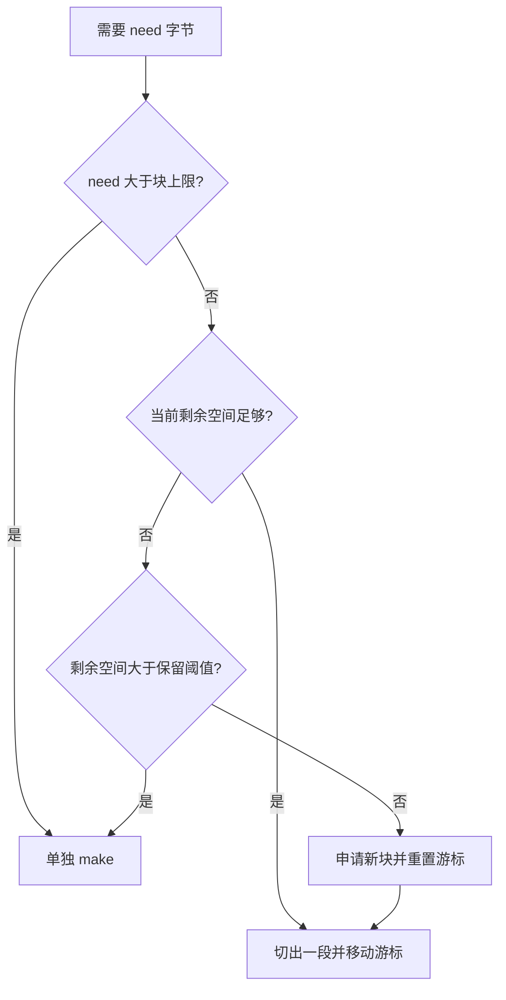
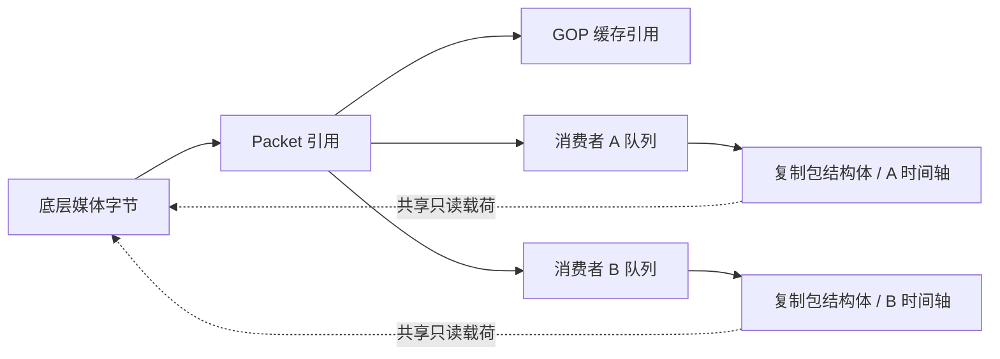

# 媒体内存分配与共享

Streamd 使用 slab 分配小包，以降低运行时分配与 GC 的 CPU 开销；消费者共享媒体载荷，以减少复制。GC 频率还受分配字节速率和存活堆影响，测量结果见 [关键设计取舍](design-decisions.md)。

## 连接内的顺序分块分配

[`rtmp/core/slab.go`](../rtmp/core/slab.go) 为输入连接提供顺序分配器，默认大块 256KiB，尾部保留阈值 64KiB；各连接独立分配，旧块由 GC 回收。

小包共享一块底层字节数组，减少每包独立申请；超大包单独申请；当前块还剩较多空间却放不下这个包时，也单独申请，留住尾部给后续小包。块大小需要根据实际包长分布选择。

**新块不会覆盖旧块。** 消费者、GOP 或队列还引用旧块里的切片时，旧块就仍然可达；这些引用都消失后，Go GC 才能回收底层数组，回收时机由 GC 决定。即使只保留一个很小的切片，也可能留住整个大块，较大的块会增加这部分保留内存。

## 共享载荷与消费者状态

[`Funnel.processor`](../rtmp/core/funnel.go) 复制 Packet 结构体，然后修改该消费者的 Baseline；slice 仍引用共同的媒体载荷。这样不必为每个观众复制整包数据，同时避免消费者互相修改时间戳。该优化减少应用层的载荷复制，协议封装和网络发送仍需单独处理。

GOP 环形槽复用包指针数组，而不是每轮重建整个容器；重置长度会保留底层数组中的旧引用，较短的新 GOP 可能使尾部引用持续到后续覆盖。队列和缓存有边界，但其保留的字节数仍取决于包大小及观众速度。Funnel 当前队列容量为 4096 个包。

## 需要复制的数据

| 数据 | 策略 | 原因 |
| --- | --- | --- |
| 普通媒体载荷 | 消费者共享 | 避免按观众数放大复制量 |
| 编码序列头 | 保存时复制 Data/Media | 隔离输入缓冲与启动头的寿命，见 `packet/boundary.go` |
| 完成的 HLS 切片 | 复制为不可变字节快照 | 避免复用封装缓冲破坏正在发送的数据，见 `hls/item/cache.go` |
| 已离开 playlist 的切片 | 短期保留后清理 | 给刚拿到旧 playlist 的观众留取片时间 |

连续媒体共享载荷，序列头和完成的 HLS 切片通过复制获得独立生命周期。

## 内存观测

同时观察分配次数、分配字节、GC、服务 RSS、队列和活动流计数；容器内存还可能包含文件缓存和 tmpfs 录像。分析内存增长时，需要结合 GC 回收时机和对象引用情况。

[性能记录](performance.md) 给出可复现的 `make` 与 slab 对照；测量范围为分配器；服务级测试还需加入真实网络、慢消费者、GOP 留存和录制。

## 与常见内存管理做法的对应关系

| 通用做法 | Streamd 的具体实现 | 适用边界 |
| --- | --- | --- |
| 分块／区域分配 | 每连接 slab 顺序切分底层数组 | 减少小对象申请；旧块仍由 GC 按可达性回收 |
| 元数据与载荷分离 | Packet 结构体按消费者复制，媒体字节共享 | 每端时间轴独立，载荷按只读约定使用 |
| 容器复用 | GOP 环形槽及包指针数组反复使用 | 旧引用保留至覆盖或清理 |
| 有界流水线 | 每个 Funnel 有独立队列，饱和时淘汰消费者 | 队列满后关闭慢消费者 |
| 生命周期快照 | 序列头和完成的 HLS 切片有意复制 | 使数据独立于输入和封装缓冲 |

NGINX 的[开发指南](https://nginx.org/en/docs/dev/development_guide.html#memory_management)也使用连续内存块组成 pool，并把 buffer 描述信息与其引用的内存分开。NGINX pool 在销毁时统一释放；Streamd 的 slab 随切片引用交给 Go GC 回收，没有显式 pool 销毁或引用计数协议。

多个小包共用大块，多个消费者共享载荷，GOP 则复用容器容量；仍被消费者引用的媒体字节保持只读。
