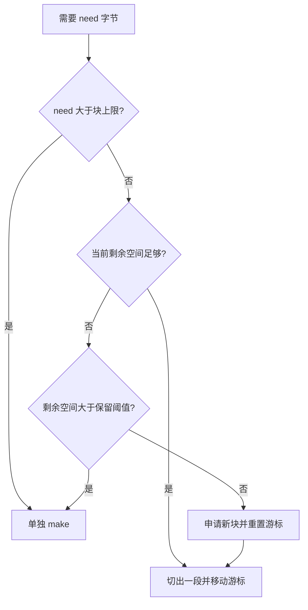
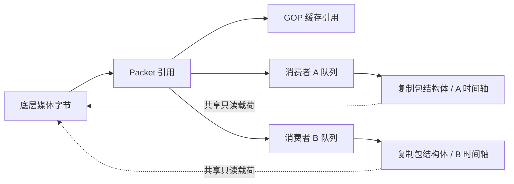

# 内存设计：减少申请，同时控制引用寿命

流媒体小包持续申请的首要优化动机是降低运行时分配与 GC 带来的 CPU 压力；slab 减少分配事件，但 GC 频率还受分配字节速率和存活堆等因素影响，具体因果与观测边界见 [关键设计取舍](design-decisions.md)。

## 连接内的顺序分块分配

[`rtmp/core/slab.go`](../rtmp/core/slab.go) 为输入连接提供顺序分配器，默认大块 256KiB，尾部保留阈值 64KiB；它没有全局共享锁，也不是需要手动归还对象的 `sync.Pool`。

小包共享一块底层字节数组，减少每包独立申请；超大包单独申请；当前块还剩较多空间却放不下这个包时，也单独申请，留住尾部给后续小包。它依赖实际包长分布，不能只看平均码率选择块大小。

**新块不会覆盖旧块。** 消费者、GOP 或队列还引用旧块里的切片时，旧块就仍然可达；这些引用都消失后，Go GC 才能回收底层数组，不是引用计数归零时同步释放。即使只保留一个很小的切片，也可能留住整个大块，因此块越大不一定越好。

## 大载荷共享，小状态独立

[`Funnel.processor`](../rtmp/core/funnel.go) 复制 Packet 结构体，然后修改该消费者的 Baseline；slice 仍引用共同的媒体载荷。这样不必为每个观众复制整包数据，同时避免消费者互相修改时间戳。写协议头和发送网络数据仍有成本，这不是操作系统层面的零拷贝。

GOP 环形槽复用包指针数组，而不是每轮重建整个容器；重置长度不等于立即清除底层数组的全部旧引用，较短的新 GOP 可能使尾部引用保留到以后覆盖。队列和缓存有边界，但其保留的字节数仍取决于包大小及观众速度。Funnel 当前队列容量为 4096 个包，是包数限制，不是 4096 字节。

## 在生命周期边界有意复制

| 数据 | 策略 | 原因 |
| --- | --- | --- |
| 普通媒体载荷 | 消费者共享 | 避免按观众数放大复制量 |
| 编码序列头 | 保存时复制 Data/Media | 隔离输入缓冲与启动头的寿命，见 `packet/boundary.go` |
| 完成的 HLS 切片 | 复制为不可变字节快照 | 避免复用封装缓冲破坏正在发送的数据，见 `hls/item/cache.go` |
| 已离开 playlist 的切片 | 短期保留后清理 | 给刚拿到旧 playlist 的观众留取片时间 |

复制并非一概有害：大部分连续媒体走共享路径，在长寿命或跨生命周期的边界复制，才能同时兼顾吞吐与正确性。

## 如何观察效果

同时观察分配次数、分配字节、GC、服务 RSS、队列和活动流计数；容器内存还可能包含文件缓存和 tmpfs 录像。RSS 未立即下降不等同于泄漏，短时分配少也不等于长期占用低。

[性能记录](performance.md) 给出可复现的 `make` 与 slab 对照；它验证分配行为，不代替带真实网络、慢消费者、GOP 留存和录制的整机测试。

## 与常见内存管理做法的对应关系

| 通用做法 | Streamd 的具体实现 | 适用边界 |
| --- | --- | --- |
| 分块／区域分配 | 每连接 slab 顺序切分底层数组 | 减少小对象申请；旧块仍由 GC 按可达性回收 |
| 元数据与载荷分离 | Packet 结构体按消费者复制，媒体字节共享 | 每端时间轴独立，载荷按只读约定使用 |
| 容器复用 | GOP 环形槽及包指针数组反复使用 | 复用容量不等于旧引用立即消失 |
| 有界流水线 | 每个 Funnel 有独立队列，饱和时淘汰消费者 | 限制积压规模，不能保证任意慢客户端持续播放 |
| 生命周期快照 | 序列头和完成的 HLS 切片有意复制 | 用一次复制换取跨阶段数据稳定 |

NGINX 的[开发指南](https://nginx.org/en/docs/dev/development_guide.html#memory_management)也使用连续内存块组成 pool，并把 buffer 描述信息与其引用的内存分开：这是可借鉴的通用思想，而非同一套实现。NGINX pool 在销毁时统一释放；Streamd 的 slab 随切片引用交给 Go GC 回收，没有显式 pool 销毁或引用计数协议。

这里的“复用”主要指多个小包共用大块、多个消费者共享载荷和 GOP 容器复用，不是把仍在使用的旧字节块重新填入新媒体；后者会破坏在途数据。现有证据支持“减少小包分配、隔离消费者状态”的工程效果，不支持独创性或行业性能排名。
