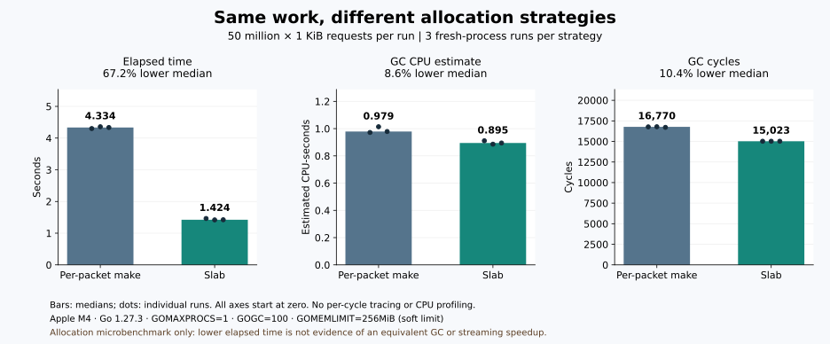

# 分配器与服务负载测试

## 分配器对照

2026-11-01，在 Apple M4、darwin/arm64、Go 1.27.3 上运行，生产代码基于 `8c54c8e`，基准实现见 [`slab_benchmark_test.go`](../rtmp/core/slab_benchmark_test.go)。每项重复三次，每次 200ms，单 CPU 执行；下表时间取中位数，原始结果在 [allocation-benchmark.txt](data/allocation-benchmark.txt)。

| 请求大小 | 每包 make：ns/op | slab：ns/op | 两者 B/op | make / slab allocs/op（工具显示值） |
| --- | ---: | ---: | ---: | --- |
| 128B | 25.00 | 9.773 | 128 | 1 / 0 |
| 1KiB | 72.73 | 48.48 | 1024 | 1 / 0 |
| 400KiB | 21435 | 21627 | 409600 | 1 / 1 |

128B、1KiB 请求的分配耗时分别约为逐包 make 的 39%、67%；400KiB 超出默认块大小，仍独立分配，没有明显收益，三次采样波动也较大。测试范围为分配器，不包含服务端到端吞吐。

小包 slab 的 `0 allocs/op` 是整数输出的舍入结果，不是永不分配：默认 256KiB 块在理想连续请求下分别承载 2048 个 128B 请求或 256 个 1KiB 请求。平均申请字节仍相同，减少的是分配事件数量；这个实验没有测出服务 RSS 的节省比例。

基准把两种实现的返回切片都保存到全局 sink，防止逐包 make 被优化为不逃逸的栈分配；每次只写首字节并保留最后一包，不模拟观众长时间保留载荷、混合包长、网络 IO 或完整媒体处理。

复现：

```sh
GOMAXPROCS=2 go test ./rtmp/core -run '^$' \
  -bench '^BenchmarkMediaAllocationComparison$' \
  -benchmem -benchtime=200ms -count=3 -cpu=1
```

## 等量工作下的 GC 开销



2026-11-01，代码 `3b807e4`，同一 Apple M4 / Go 1.27.3 环境，以外置测量程序调用生产 slab；每策略三个独立进程，各申请 5000 万个 1KiB 包，仅保留最后一包。设置 `GOMAXPROCS=1`、`GOGC=100`、`GOMEMLIMIT=256MiB`（Go 软内存上限），计时前执行一次 GC；运行期间关闭逐次 GC 日志和 CPU profile，通过 runtime.MemStats 与 runtime/metrics 差分采样。

柱高是三轮中位数，黑点是各轮结果，纵轴均从零开始；[原始数据](data/gc-comparison.json)保留每轮数值。

| 指标 | 逐包 make | slab | 中位数变化 |
| --- | ---: | ---: | ---: |
| 总耗时 | 4.334 秒 | 1.424 秒 | −67.2% |
| GC CPU 估计值 | 0.979 CPU 秒 | 0.895 CPU 秒 | −8.6% |
| GC 周期 | 16,770 | 15,023 | −10.4% |

两者累计申请字节均约 51.20GB，但分配次数约从 5000 万降到 19.5 万；GC CPU 的估计差只占总耗时差的一部分。此处 GC CPU 来自运行时计数器，测试负载为连续分配并保留最后一包。前一节微基准报告单次操作耗时，本节报告固定总量的处理耗时。

## 分块大小敏感性

[64–512KiB 分块实验](slab-sizing.md)进一步比较 GC CPU 与引用留存成本，包含两类负载、三轮原始数据与图表。

## 1C2G 的受限容量对照

以下为 2026-10-31 对 `75351b018ad16af796fcae2e377c26699a18ffc0` 的实测结果。环境是本机 ARM64 Linux 容器：服务单独限制 1 CPU / 2GiB，客户端另限 1 CPU / 768MiB。

输入为循环播放的 720p/24fps H.264/AAC 素材，每连接约 0.70Mbps；服务不转码，开启 HLS 和 TS 录制，录制使用 tmpfs。每场 HLS 就绪后接收约 20 秒，客户端校验 HTTP-FLV 媒体结构，不为所有连接实时解码。CPU 单位为核，0.1 表示约使用一个核的 10%。

| 推流路数 | HTTP-FLV 观众数 | 服务容器平均 / 峰值 CPU | 服务峰值 RSS | 合计播放速率 |
| ---: | ---: | --- | ---: | ---: |
| 1 | 1 | 0.039 / 0.042 | 20.9MiB | 0.70Mbps |
| 4 | 4 | 0.055 / 0.063 | 41.1MiB | 2.80Mbps |
| 8 | 8 | 0.092 / 0.110 | 61.6MiB | 5.62Mbps |
| 16 | 16 | 0.128 / 0.155 | 107.8MiB | 11.27Mbps |
| 1 | 8 | 0.051 / 0.057 | 117.9MiB | 5.59Mbps |
| 1 | 32 | 0.077 / 0.099 | 138.0MiB | 22.39Mbps |
| 1 | 64 | 0.116 / 0.162 | 140.6MiB | 44.79Mbps |

这些档位按顺序执行，录制数据在场景间累计；RSS 峰值同时受到进程历史和回收时机影响。最后空闲 RSS 约 25.8MiB，活动流、播放和录制计数归零。

测试分别运行到 16 路推流各带 1 个 HTTP-FLV 观众，以及单路推流带 64 个 HTTP-FLV 观众，达到预设档位后停止，未继续探测容量上限。较低的公网出口带宽可能先于 CPU 限制容量。

## 30 分钟连续负载

同一生产代码版本，独立场景下运行 1 路推流、16 个 HTTP-FLV 观众、HLS 和 TS 录制：16 个连接均完成，最短接收时间 1800.58 秒；服务进程平均 CPU 约 0.034 核，峰值 RSS 25.8MiB，结束后 RSS 23.1MiB。容器峰值内存约 224.7MiB，其中包含 tmpfs 录像。

301 个 TS 文件全部通过离线 FFmpeg 解码和切片内 DTS 检查，共解码 43,273 帧；未发生 OOM，结束后协程数回到 14 的基线。

## 如何验证自己的部署

先用 `make e2e-relay` 验证两台本地进程的推流→拉流→三协议播放及录制链路；使用 `make e2e-list` 查看其他场景。FFmpeg/ffprobe 是测试依赖。

容量测试应固定实际码率、观众协议、磁盘和带宽，将推流客户端与服务端分别限额，逐档增加连接并观察 CPU、RSS、GC、队列饱和、播放连续性和录制错误；生产容量需要在目标环境中测量。上述微基准命令仅复现分配器测试，容器容量测试需要另行配置客户端、存储与资源限额。
