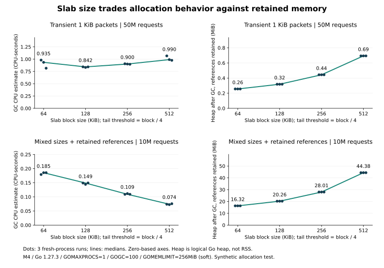

# Slab 分块大小：GC CPU 与保留内存的取舍

混合包＋引用留存场景中，大块减少 GC CPU 估计开销，却明显增加被小切片留住的内存；连续小包场景则没有单调收益。默认块大小为 256KiB。

## 方法

2026-11-01，生产代码基于 `916cf61`，Apple M4 / darwin arm64 / Go 1.27.3；外置程序调用实际 `core.NewSlab` 和 `Slab.Init`，不修改生产实现。分别测试 64、128、256、512KiB，尾部保留阈值始终为块大小的四分之一，因此实验改变的是按原默认比例缩放的一组参数，并未单独研究尾部阈值。

每组使用三个新进程，轮次间反转大小顺序；`GOMAXPROCS=1`、`GOGC=100`、`GOMEMLIMIT=256MiB`，每进程超时 60 秒。关闭逐次 GC 日志和 CPU profile，测量运行时计数器；每次只写载荷首字节，不模拟拷贝整包或网络传输。

| 场景 | 固定处理量 | 引用留存方式 |
| --- | --- | --- |
| 连续小包 | 5000 万个 1KiB 请求 | 只保存最后一个切片 |
| 混合包＋留存 | 1000 万次；每 100 个中 95 个 1KiB、4 个 32KiB、1 个 400KiB | 环形缓存保留最近 2048 包；另每 1024 包保存一个 128B 切片，轮换保留 64 个，模拟稀疏长寿命引用 |

混合分布是人为构造的压力模型，不是线上采样；两个场景处理量和保留方式不同，只在各自场景内横向比较。

计时前执行一次 GC；运行期间采集 GC 周期和 `/cpu/classes/gc/total:cpu-seconds` 的增量，后者是运行时 CPU **估计值**，不是系统 CPU 精确计时。结束后额外强制 GC，并用 `runtime.KeepAlive` 保留缓存、slab 和最后一个切片，再读取 `HeapAlloc`：该值表示引用仍在时的逻辑 Go 堆，包含少量程序基础对象，既非 RSS，也非泄漏量；结束后的强制 GC 不计入运行期 GC CPU。

## 结果（三轮中位数）

| 场景 | 块大小 KiB | 总耗时 秒 | GC CPU 估计 秒 | GC 周期 | GC 后保留堆 MiB |
| --- | ---: | ---: | ---: | ---: | ---: |
| 连续小包 | 64 | 2.024 | 0.935 | 15759 | 0.26 |
| 连续小包 | 128 | 1.378 | 0.842 | 13950 | 0.32 |
| 连续小包 | 256 | 1.430 | 0.900 | 15023 | 0.44 |
| 连续小包 | 512 | 1.592 | 0.990 | 16275 | 0.69 |
| 混合包＋留存 | 64 | 0.869 | 0.185 | 2524 | 16.32 |
| 混合包＋留存 | 128 | 0.840 | 0.149 | 2063 | 20.26 |
| 混合包＋留存 | 256 | 0.841 | 0.109 | 1489 | 28.01 |
| 混合包＋留存 | 512 | 0.811 | 0.074 | 1004 | 44.38 |

[原始 24 轮数据](data/slab-size-results.json)包括分配字节、次数、GC assist、采样堆峰值和基线。图上散点为各轮结果，线为中位数；只跑三轮，未做显著性分析，连续小包的 64KiB 耗时尤其有波动（1.46–2.23 秒），不能凭这张表认定 128KiB 是生产最优值。

## 为什么会这样

- 小块让独立分配更频繁，但单个残留切片拖住的底层块较小；大块摊薄部分分配工作，却提高引用留存成本。
- 混合场景的 64→512KiB，GC CPU 估计减少约 60%，保留堆增加约 2.7 倍，总耗时只减少约 7%；“GC 更少”不等于总体性能按同等比例提升。
- 更多存活堆会影响 GC 的堆目标，减少 GC 频率本身也可能体现空间换时间，而不只是分配器更高效。
- 400KiB 包在前三档超过块上限，独立分配；在 512KiB 档可以落入 slab。尾部浪费与持有关系随之变化，混合场景累计分配从约 59.51GiB 增到 61.95GiB，不能把大块简单理解为“更省内存”。
- 连续小包累计分配约 47.68GiB，各档基本一致；即便申请次数下降，GC 仍受分配字节、堆目标和持有方式影响，没有随块变大一直改善。

## 峰值与限制

程序每 4096 次请求采样一次 HeapAlloc，此采样本身也有开销，并可能漏掉峰值；观察到混合场景的 256KiB 档采样峰值最高约 374.8MiB，超过配置的 256MiB **软限制**，不能把 GOMEMLIMIT 当作操作系统硬配额，也不能拿结束后 28MiB 的保留堆代表运行峰值。原始数据包含全部轮次。

实验只观测逻辑 Go 堆，不测 RSS；只写首字节也不能代表真实媒体数据触页的物理内存成本。要决定生产块大小，还需固定真实码率、包长分布、消费者数量及缓存持有时间，在操作系统硬内存限额下验证端到端延迟、吞吐和峰值 RSS。
